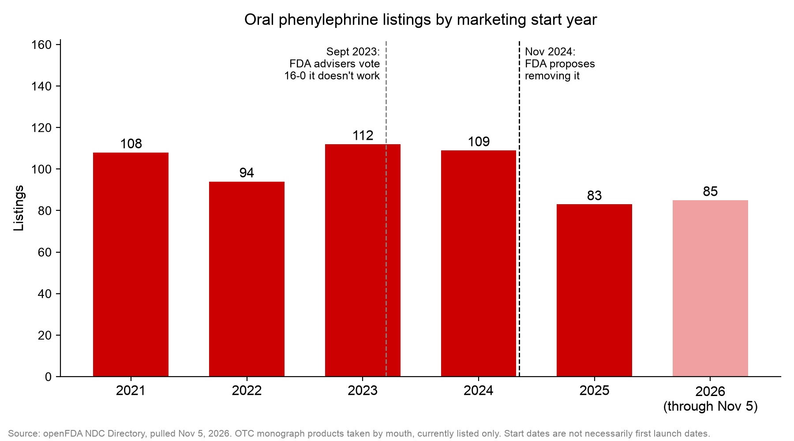

# phenylephrine-analysis

How many new phenylephrine cold medicines have been listed with the FDA since the FDA proposed getting rid of it?

I did this for a piece on my Substack, [Supply & State](https://sav1440604.substack.com). It's also me practicing pulling data from an API and cleaning it in Python.

## Purpose

I started this after a cold. I was looking up which over-the-counter decongestants actually work and learned that pseudoephedrine, the one with good evidence behind it, is kept behind the pharmacy counter because of a 2006 law meant to fight meth. Most of the cold medicine on the open shelf uses phenylephrine instead, which an FDA advisory committee voted 16-0 doesn't work when taken by mouth. I assumed it had been pulled after that vote. It hadn't, so I wanted to find out whether companies were still releasing new products with it.

## Background

Phenylephrine is the decongestant in most cold medicine sold on the open shelf (DayQuil, NyQuil, Sudafed PE, store brands). In September 2023 an FDA advisory committee voted 16-0 that the oral dose doesn't work. In November 2024 the FDA proposed removing oral phenylephrine from the OTC monograph (proposed order OTC000036). When I checked on November 5, 2026 there still wasn't a final order, so companies can keep selling it and keep listing new products with it.

## Results

| | Count |
|---|---|
| All phenylephrine records in the NDC Directory | 1,710 |
| Oral, OTC monograph, finished products | 1,233 |
| Listed after the Sept 12, 2023 vote | 297 |
| Listed after the Nov 8, 2024 proposal | 175 |

| Year | New listings |
|---|---|
| 2021 | 108 |
| 2022 | 94 |
| 2023 | 112 |
| 2024 | 109 |
| 2025 | 83 |
| 2026 (through Nov 5) | 85 |

Listings went down some in 2025 but were still more than one a week. The newest one in the data is a kids cough and cold drop for ages 2 to 6, listed October 6, 2026.



## Data

openFDA NDC Directory API (`api.fda.gov/drug/ndc.json`), pulled November 5, 2026 (date saved in `data/raw/pulled_on.txt`).

## How I filtered it

I counted a product if:

- `product_type` is `HUMAN OTC DRUG`
- `route` includes `ORAL`
- `marketing_category` starts with `OTC MONOGRAPH` (there's `OTC MONOGRAPH DRUG` plus 14 records with older labels like `OTC MONOGRAPH FINAL`, I kept all of them)
- `finished` is true

I left nasal sprays out because the FDA finding only covers phenylephrine you swallow. The spray works.

## Limitations

- The directory only has products that are listed right now. Anything discontinued isn't there, so older years are undercounted. That's why the chart starts at 2021 and not earlier.
- A listing isn't always a new formula. Store brands and relabels get their own NDC, so these are new product listings, not new drugs.
- `marketing_start_date` is whatever the company reported. I didn't check every one.
- I checked 2 of the newest listings by hand against their labels (G-Supress DX Pediatric Drops and GoodMeds Daytime Cold & Flu). Both list phenylephrine HCl as a nasal decongestant.

## Files

Run these in order:

1. `01_fetch_data.py` downloads the raw records
2. `02_explore.py` prints a summary of what's in the raw data
3. `03_clean.py` filters to oral OTC products, counts listings after each FDA date, saves `data/oral_otc_phenylephrine.csv`
4. `04_chart.py` makes the chart

```
python3 -m venv venv
source venv/bin/activate
pip install -r requirements.txt
python 01_fetch_data.py
python 03_clean.py
python 04_chart.py
```

Counts might be a little different if you pull on a different day since the directory changes constantly.

## Sources

- [FDA proposed order OTC000036](https://www.accessdata.fda.gov/scripts/cder/omuf/index.cfm?event=OrderDetail&orderid=OTC000036)
- [FDA 2023 advisory committee briefing document](https://fda.gov/media/171915/download)
- [openFDA NDC API](https://open.fda.gov/apis/drug/ndc/)
